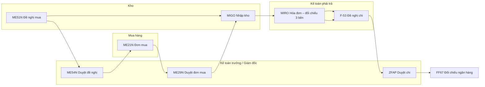
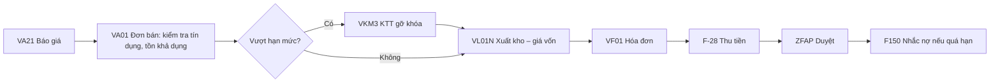
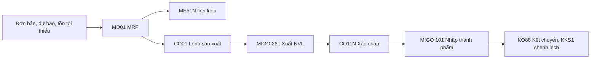
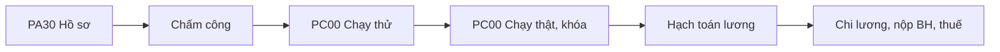
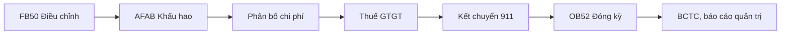

# ERP Lab 2.0 – Đặc tả hệ thống (SPEC)

Phiên bản đặc tả: 1.0 (P0, 11/11/2026). Đây là nguồn sự thật cho mọi giai đoạn P1–P13. Thay đổi đặc tả phải ghi vào mục 12 "Nhật ký thay đổi đặc tả" kèm lý do.

## 1. Mục tiêu, phạm vi, giản lược

**Mục tiêu.** Một ERP thu nhỏ vận hành theo logic nghiệp vụ SAP S/4HANA (FI, CO, MM, SD, PP, HCM) để sinh viên chưa có điều kiện tiếp cận ERP thật vẫn thực hành được trọn chu trình: dữ liệu gốc → chứng từ nghiệp vụ → bút toán tự động → sổ sách → khóa sổ → báo cáo → kiểm toán. Kèm bộ bài tập thực chiến tự chấm.

**Không phải là.** ERP Lab không phải SAP, không dùng logo, tên sản phẩm hay giao diện của SAP. Chỉ mượn mã giao dịch (T-code) và trình tự nghiệp vụ để sinh viên quen thuật ngữ. Chân trang ghi "Mô phỏng giáo dục độc lập, không liên kết với SAP SE".

**Giản lược có chủ đích** (phải ghi chú trên màn hình liên quan):

| SAP S/4HANA | ERP Lab |
| --- | --- |
| Universal Journal ACDOCA với hàng trăm trường | `erp_je_line` với khoảng 15 trường (tài khoản, đối tượng, vật tư, trung tâm chi phí, lệnh, tài sản, thuế) |
| Account determination OBYC với nhiều khóa giao dịch | Bảng `erp_acct_det` vài chục dòng |
| Chiến lược phát hành nhiều điều kiện | Duyệt theo giá trị, tối đa 2 cấp |
| Định giá theo moving average / standard price trên từng plant | Bình quân di động theo công ty; giá định mức cho thành phẩm từ P7 |
| Hàng nghìn bảng cấu hình | Tham số trong SPRO, sửa được bởi giảng viên |
| Ngày hệ thống thật | "Ngày làm việc" do giảng viên điều khiển (P3) để chạy trọn một tháng trong vài buổi |

## 2. Kiến trúc kỹ thuật

- Trình duyệt: HTML, CSS, JavaScript thuần, không build, chạy từ GitHub Pages. Từ P1 mã tách thành `erp/css/erp.css` và các tệp `erp/js/*.js` nạp theo thứ tự (script thường, dùng chung phạm vi toàn cục). Không dùng ES modules để khỏi viết lại 1.400 dòng đang chạy ổn; mỗi phân hệ mới là một tệp `erp/js/mod-*.js` gọi `erpModule({...})` để đăng ký T-code, màn hình, biểu mẫu.
- Máy chủ: Supabase (PostgreSQL). Bảng không mở cho `anon`/`authenticated`; mọi truy cập qua hàm RPC `security definer`. Mọi quy tắc nghiệp vụ, phân quyền và lập bút toán nằm trên máy chủ.
- SQL: tệp đánh số `erp/sql/NNN_ten.sql`, chạy lại nhiều lần vẫn an toàn. `erp/setup.sql` là tệp gộp sinh từ `erp/sql/*.sql` bằng `erp/tools/build-setup.sh` để giảng viên chỉ chạy một tệp.
- Môi trường: phát triển trên nhánh `erp2` và project Supabase `erp-lab-dev`; lớp học dùng nhánh `main` và project `erp-lab`. Chỉ phát hành ở P13 khi giảng viên xác nhận.

## 3. Cấu trúc tổ chức

| Cấp SAP | ERP Lab | Giai đoạn |
| --- | --- | --- |
| Client | Một project Supabase (một lớp) | có |
| Company code | C01–C08, dữ liệu tách biệt | có |
| Plant / Storage location | Nhà máy 1000 Nha Trang; kho 1001 NVL, 1002 Thành phẩm, 1003 Hàng hóa | P2 |
| Purchasing org / Sales org | 1 tổ chức mua; 1 tổ chức bán, kênh 10 bán buôn, 20 bán lẻ | P2 |
| Controlling area | Một vùng; trung tâm chi phí theo phòng ban; trung tâm lợi nhuận theo dòng sản phẩm | P2, P8 |
| Fiscal year variant | Năm dương lịch, 12 kỳ tháng | P3 |

Doanh nghiệp mô phỏng: Công ty CP Thương mại Cánh Buồm 01–08, phân phối thiết bị tin học tại Nha Trang; từ P7 thêm hoạt động lắp ráp máy tính bộ từ linh kiện.

## 4. Phòng ban, vai trò, ma trận quyền

### 4.1. Vai trò

| Mã | Vai trò | Phòng ban | Có từ |
| --- | --- | --- | --- |
| GD | Giám đốc | Ban Giám đốc | P2 |
| MH | Nhân viên mua hàng | Mua hàng | có |
| KHO | Thủ kho | Kho vận | có |
| KD | Nhân viên kinh doanh | Kinh doanh | có |
| SX | Kế hoạch – Quản đốc | Sản xuất | P7 |
| NS | Nhân sự – tiền lương | Nhân sự | P9 |
| AP | Kế toán phải trả | Kế toán | P2 (tách từ KT) |
| AR | Kế toán phải thu | Kế toán | P2 (tách từ KT) |
| GT | Kế toán kho – giá thành | Kế toán | P7 |
| TS | Kế toán TSCĐ | Kế toán | P6 |
| TH | Kế toán tổng hợp | Kế toán | P3 |
| TQ | Thủ quỹ | Kế toán | P3 |
| KTT | Kế toán trưởng | Kế toán | có |
| KSNB | Kiểm toán nội bộ (chỉ đọc) | Kiểm soát nội bộ | P11 |
| GV | Giảng viên | Quản trị hệ thống | có |

Vai trò `KT` của bản 1 được giữ đến hết P1; từ P2 ánh xạ sang AP + AR.

### 4.2. Ma trận vai trò × giao dịch (L = lập, D = duyệt, X = xem)

| T-code | Nghiệp vụ | GD | MH | KHO | KD | AP | AR | TH | TQ | KTT | KSNB |
| --- | --- | --- | --- | --- | --- | --- | --- | --- | --- | --- | --- |
| ME51N | Đề nghị mua | X | X | L | | | | | | D | X |
| ME21N | Đơn mua | D (cấp 2) | L | X | | X | | | | D | X |
| MIGO | Nhập/xuất kho | | X | L | | X | | | | X | X |
| MIRO | Hóa đơn mua | | X | | | L | | | | D (gỡ khóa) | X |
| F-53 / F110 | Thanh toán NCC | D (cấp 2) | | | | L | | | | D | X |
| VA01 | Đơn bán | | | X | L | | X | | | D (tín dụng) | X |
| VL01N | Giao hàng | | | L | X | | | | | X | X |
| VF01 | Hóa đơn bán | | | | X | | L | | | X | X |
| F-28 | Thu tiền | | | | | | L | | | D | X |
| FBCJ | Sổ quỹ | | | | | | | | L | D | X |
| FB50 | Bút toán tay | | | | | | | L | | D | X |
| OB52 | Mở/đóng kỳ | X | | | | | | | | L | X |
| FS00, XK01, XD01, MM01 | Dữ liệu gốc | | L (NCC, vật tư) | | L (khách) | | | | | D (trường nhạy cảm) | X |

Cột GD ở P1 chưa có hiệu lực. Ma trận đầy đủ cho P6–P9 bổ sung khi tới giai đoạn đó.

### 4.3. Ma trận xung đột (điểm 0–3, ≥2 là xung đột cần cảnh báo)

| Cặp | Điểm | Rủi ro |
| --- | --- | --- |
| KHO + KT/AP/AR | 3 | Vừa giữ hàng vừa ghi sổ |
| MH + KHO | 2 | Tự đặt mua và tự nhận hàng |
| MH + AP | 2 | Tự đặt mua và tự đề nghị trả tiền |
| KD + AR | 2 | Tự bán và tự xóa nợ |
| TQ + TH/AP/AR | 3 | Giữ tiền và ghi sổ |
| KTT + mọi vai trò lập | 3 | Tự lập tự duyệt |
| MH + KD | 0 | – |
| KHO + KD | 1 | Vừa bán vừa xuất kho |

## 5. Danh mục T-code theo phân hệ

Trạng thái: **có** = đang chạy ở bản 1; **sửa** = giữ nhưng đổi logic; **mới** = thêm ở giai đoạn ghi trong ngoặc.

- **MM**: ME51N có · ME5A có · ME21N sửa (P1: tổng tiền và duyệt tính trên máy chủ) · ME2N có · MIGO sửa (P1: bút toán máy chủ; P4: loại di chuyển 122, 201, 311, 551) · MB51 có · MMBE có · MM01/02/03 mới (P2) · XK01/02/03 mới (P2) · ME11 mới (P2) · ME41/47/49 mới (P4) · MI01/04/07 mới (P4).
- **SD**: VA01 sửa (P1: kiểm tra tín dụng trên máy chủ) · VA05 có · VL01N sửa (P1: giá vốn máy chủ) · VF01 sửa (P1) · VF05 có · VKM3 có · XD01/02/03 mới (P2) · VK11, VA21, VF11, trả hàng mới (P5) · F150 mới (P5).
- **FI**: MIRO sửa (P1: khóa thanh toán do máy chủ quyết định) · MIR5 có · F-53 có · F-28 có · FBL1N có · FBL5N có · ZNKC có · F.01 có · FS00 mới (P2) · FB50, FB03, FB08, FBS1, FAGLL03, OB52, FBCJ, FF67 mới (P3) · F-48, F-29, F-44, F-32, F110 mới (P4–P5) · AS01, F-90, AFAB, ABAVN, AW01N mới (P6).
- **PP**: CS01, CA01, MD01, CO01, CO11N, KO88 mới (P7).
- **CO**: KS01, KP06, KSB1, CK11N, KKS1, KE30 mới (P8).
- **HCM**: PA30, chấm công, PC00 mới (P9).
- **Đóng kỳ**: ZCLOSE, tờ khai GTGT, báo cáo tài chính mới (P10).
- **Phê duyệt**: SBWP, ME54N, ME29N, MRBR, VKM3, ZFAP có.
- **Quản trị, kiểm toán**: SU01, PFCG, SPRO, ZOVR có · ZCASE có (thay bằng ZBT ở P12) · SM20, SUIM, ZRCM, SE16N, ZAUDIT, ZSEED mới (P11).

## 6. Mô hình dữ liệu đích

| Bảng | Nội dung | Giai đoạn |
| --- | --- | --- |
| `erp_user`, `erp_session`, `erp_cfg` | Người dùng, phiên, tham số | có |
| `erp_doc` | Chứng từ nghiệp vụ (PR, PO, GR, IV, PAY, SO, DL, BI, RC, OB…) dạng jsonb, có trạng thái và lịch sử | có |
| `erp_acct` | Hệ thống tài khoản: số hiệu, tên, loại, tài khoản đối chiếu, cho ghi tay, bắt buộc trung tâm chi phí | P1 |
| `erp_acct_det` | Xác định tài khoản: khóa nghiệp vụ → tài khoản | P1 |
| `erp_mat`, `erp_partner` | Dữ liệu gốc vật tư, đối tác theo công ty | P1 tối thiểu, P2 đầy đủ |
| `erp_val` | Tồn kho định giá bình quân di động theo công ty × vật tư | P1 |
| `erp_je`, `erp_je_line` | Sổ nhật ký hợp nhất: đầu và dòng chứng từ kế toán | P1 |
| `erp_period` | Kỳ kế toán mở/đóng theo nhóm tài khoản | P3 |
| `erp_change_log` | Nhật ký thay đổi dữ liệu gốc | P2 |
| `erp_audit_log` | Nhật ký hệ thống, chỉ thêm | P11 |
| `erp_role_perm`, `erp_role_pack` | Quyền vai trò × T-code × hành động; gói vai trò theo bài tập | P2 |
| `erp_ex`, `erp_ex_result` | Bài tập và kết quả chấm | P12 |

`erp_doc.data.je` từ P1 chỉ là bản sao do máy chủ ghi để giao diện hiển thị; nguồn sự thật là `erp_je_line`. Kiểm thử P1 khẳng định hai nguồn trùng nhau.

## 7. Hệ thống tài khoản

Căn cứ: Phụ lục II Thông tư 99/2025/TT-BTC (71 tài khoản cấp 1). Danh sách dưới đây lấy theo bản trích Phụ lục II của Kế toán Lê Ánh (https://ketoanleanh.edu.vn/kinh-nghiem-ke-toan/he-thong-tai-khoan-ke-toan-theo-thong-tu-992025tt-btc.html), **CẦN GIẢNG VIÊN KIỂM TRA** đối chiếu bản gốc.

**Phát hiện ở P0.** Bản 1 dùng 1111, 1121, 1561, 5111: đây là số hiệu tài khoản cấp 2 của Thông tư 200. Phụ lục II Thông tư 99 không có cấp 2 cho các tài khoản 111, 112, 156, 511 (chỉ còn 111 Tiền mặt, 112 Tiền gửi không kỳ hạn, 156 Hàng hóa, 511 Doanh thu bán hàng và cung cấp dịch vụ). Điều 11 Thông tư 99 cho doanh nghiệp tự mở thêm tài khoản chi tiết nếu ban hành quy chế. ERP Lab chọn **dùng đúng số hiệu Phụ lục II**, chi tiết theo ngân hàng, vật tư, đối tượng bằng trường của dòng bút toán chứ không mở tài khoản con. Từ P1: 1111→111, 1121→112, 1561→156, 5111→511, 411→4111.

| Số hiệu | Tên | Loại | Đối chiếu | Ghi tay | Dùng từ |
| --- | --- | --- | --- | --- | --- |
| 111 | Tiền mặt | Tài sản | | Có | P1 |
| 112 | Tiền gửi không kỳ hạn | Tài sản | | Có | P1 |
| 113 | Tiền đang chuyển | Tài sản | | Không | P3 |
| 131 | Phải thu của khách hàng | Tài sản | Phải thu | Không | P1 |
| 1331 | Thuế GTGT được khấu trừ của hàng hóa, dịch vụ | Tài sản | | Có | P1 |
| 1332 | Thuế GTGT được khấu trừ của TSCĐ | Tài sản | | Có | P6 |
| 1381 | Tài sản thiếu chờ xử lý | Tài sản | | Có | P3 |
| 1388 | Phải thu khác | Tài sản | | Có | P3 |
| 141 | Tạm ứng | Tài sản | Tạm ứng | Không | P3 |
| 151 | Hàng mua đang đi đường | Tài sản | Kho | Không | P4 |
| 152 | Nguyên liệu, vật liệu | Tài sản | Kho | Không | P7 |
| 153 | Công cụ, dụng cụ | Tài sản | Kho | Không | P6 |
| 154 | Chi phí sản xuất, kinh doanh dở dang | Tài sản | | Không | P7 |
| 155 | Sản phẩm | Tài sản | Kho | Không | P7 |
| 156 | Hàng hóa | Tài sản | Kho | Không | P1 |
| 157 | Hàng gửi đi bán | Tài sản | Kho | Không | P5 |
| 211 | Tài sản cố định hữu hình | Tài sản | TSCĐ | Không | P6 |
| 213 | Tài sản cố định vô hình | Tài sản | TSCĐ | Không | P6 |
| 2141 | Hao mòn TSCĐ hữu hình | Tài sản (điều chỉnh giảm) | TSCĐ | Không | P6 |
| 2143 | Hao mòn TSCĐ vô hình | Tài sản (điều chỉnh giảm) | TSCĐ | Không | P6 |
| 2293 | Dự phòng phải thu khó đòi | Tài sản (điều chỉnh giảm) | | Có | P5 |
| 2294 | Dự phòng giảm giá hàng tồn kho | Tài sản (điều chỉnh giảm) | | Có | P10 |
| 2411 | Mua sắm TSCĐ | Tài sản | | Không | P6 |
| 242 | Chi phí chờ phân bổ | Tài sản | | Có | P3 |
| 331 | Phải trả cho người bán | Nợ phải trả | Phải trả | Không | P1 |
| 33311 | Thuế GTGT đầu ra | Nợ phải trả | | Có | P1 |
| 3334 | Thuế thu nhập doanh nghiệp | Nợ phải trả | | Có | P10 |
| 3335 | Thuế thu nhập cá nhân | Nợ phải trả | | Có | P9 |
| 3339 | Phí, lệ phí và các khoản phải nộp khác | Nợ phải trả | | Có | P10 |
| 334 | Phải trả người lao động | Nợ phải trả | Lương | Không | P9 |
| 335 | Chi phí phải trả | Nợ phải trả | | Có | P3 |
| 3381 | Tài sản thừa chờ giải quyết | Nợ phải trả | | Có | P3 |
| 3382 | Kinh phí công đoàn | Nợ phải trả | | Có | P9 |
| 3383 | Bảo hiểm xã hội | Nợ phải trả | | Có | P9 |
| 3384 | Bảo hiểm y tế | Nợ phải trả | | Có | P9 |
| 3386 | Bảo hiểm thất nghiệp | Nợ phải trả | | Có | P9 |
| 3387 | Doanh thu chờ phân bổ | Nợ phải trả | | Có | P5 |
| 3388 | Phải trả, phải nộp khác | Nợ phải trả | | Có | P3 |
| 3411 | Các khoản đi vay | Nợ phải trả | | Có | P3 |
| 4111 | Vốn góp của chủ sở hữu | Vốn chủ sở hữu | | Có | P1 |
| 4211 | Lợi nhuận sau thuế chưa phân phối lũy kế đến cuối năm trước | Vốn chủ sở hữu | | Có | P10 |
| 4212 | Lợi nhuận sau thuế chưa phân phối năm nay | Vốn chủ sở hữu | | Có | P10 |
| 511 | Doanh thu bán hàng và cung cấp dịch vụ | Doanh thu | | Không | P1 |
| 515 | Doanh thu hoạt động tài chính | Doanh thu | | Có | P3 |
| 521 | Các khoản giảm trừ doanh thu | Giảm trừ doanh thu | | Không | P5 |
| 621 | Chi phí nguyên liệu, vật liệu trực tiếp | Chi phí | | Không | P7 |
| 622 | Chi phí nhân công trực tiếp | Chi phí | | Không | P7 |
| 6271–6278 | Chi phí sản xuất chung (theo yếu tố) | Chi phí | | Có, bắt buộc TTCP | P7 |
| 632 | Giá vốn hàng bán | Chi phí | | Không | P1 |
| 635 | Chi phí tài chính | Chi phí | | Có | P3 |
| 6411–6418 | Chi phí bán hàng (theo yếu tố) | Chi phí | | Có, bắt buộc TTCP | P3 |
| 6421–6428 | Chi phí quản lý doanh nghiệp (theo yếu tố) | Chi phí | | Có, bắt buộc TTCP | P3 |
| 711 | Thu nhập khác | Thu nhập | | Có | P6 |
| 811 | Chi phí khác | Chi phí | | Có | P6 |
| 82111 | Chi phí thuế TNDN hiện hành theo quy định của Luật thuế TNDN | Chi phí | | Có | P10 |
| 911 | Xác định kết quả kinh doanh | Kết chuyển | | Không | P10 |

P1 nạp toàn bộ danh mục trên vào `erp_acct` để các giai đoạn sau chỉ cần bật dùng.

## 8. Xác định tài khoản (bút toán tự động)

| Khóa | Nghiệp vụ | Nợ | Có | Ghi chú |
| --- | --- | --- | --- | --- |
| OB | Mở sổ đầu kỳ | 111, 112, 156 (theo vật tư) | 4111 | Một chứng từ mở sổ mỗi công ty |
| GR101 | Nhập kho theo đơn mua (MIGO 101) | 156 (vật tư, số lượng, giá đơn mua) | 331 (NCC) tạm tính theo giá đơn mua | Thực hành Việt Nam: hàng về trước, hóa đơn sau; xem mục 11 quyết định D5 |
| IV | Hóa đơn mua (MIRO) | 1331 (thuế GTGT); 156 nếu giá hóa đơn > giá đơn mua | 331 (NCC) phần thuế và chênh lệch; 156 nếu giá hóa đơn < giá đơn mua | Lệch quá dung sai → ghi sổ nhưng khóa thanh toán |
| PAY | Chi trả NCC (F-53) khi duyệt | 331 (NCC) | 111 hoặc 112 | Kiểm tra số dư trước khi duyệt |
| DL601 | Xuất kho giao hàng (VL01N) | 632 | 156 (vật tư, số lượng, giá bình quân) | Giá vốn máy chủ tính |
| BI | Hóa đơn bán (VF01) | 131 (khách) tổng thanh toán | 511 tiền hàng; 33311 thuế | |
| RC | Thu tiền (F-28) khi duyệt | 111 hoặc 112 | 131 (khách) | |

Giá xuất kho: bình quân gia quyền di động theo công ty × vật tư; khi xuất hết số lượng còn lại thì giá vốn bằng toàn bộ giá trị còn lại (không để dư lẻ do làm tròn).

**Giản lược đã biết (ghi chú cho P4):** chênh lệch giá ở MIRO luôn ghi vào 156; khi hàng đã xuất bán hết, đúng ra phần chênh lệch tương ứng phải vào 632.

## 9. Năm quy trình

Mỗi quy trình có lưu đồ chi tiết theo làn phòng ban, chứng từ, số liên và điểm kiểm soát trong tài liệu bài tập của giai đoạn tương ứng.

## 10. Bảy bất biến

1. Mọi bút toán do máy chủ lập từ `erp_acct_det`; trình duyệt không gửi được dòng Nợ/Có, trừ FB50 (từ P3) và FB50 phải qua duyệt.
2. Từng chứng từ kế toán có tổng Nợ bằng tổng Có.
3. Sổ phụ (công nợ, kho, TSCĐ) luôn khớp tài khoản tổng hợp; tài khoản đối chiếu không nhận bút toán tay.
4. Không ghi được vào kỳ đã đóng (từ P3).
5. Chứng từ đã ghi sổ không sửa, không xóa; chỉ đảo bằng chứng từ mới có tham chiếu. Ngoại lệ duy nhất: giảng viên làm mới dữ liệu một công ty (SPRO), có ghi nhật ký.
6. Người lập khác người duyệt; mọi ngoại lệ (tự duyệt khi kiêm nhiệm) ghi nhật ký kèm lý do.
7. Mọi chứng từ truy được về chứng từ gốc và xuôi đến bút toán.

## 11. Quyết định đã chốt

| Mã | Quyết định | Lý do |
| --- | --- | --- |
| D1 | Doanh nghiệp sản xuất – thương mại (lắp ráp máy tính từ P7) | Mở được PP và giá thành; giữ được dữ liệu bản 1. Giảng viên chưa trả lời, áp dụng đề xuất mặc định |
| D2 | Học phần Hệ thống thông tin kế toán, 8–10 buổi | Như trên |
| D3 | Phát triển bằng Claude Code trên nhánh `erp2` + `erp-lab-dev` | Đã có quyền ghi kho và tạo project |
| D4 | Giữ nguyên `erp-lab` của lớp đang học; phát hành 2.0 đầu học kỳ sau | Không rủi ro cho lớp; project `erp-lab` đang tạm dừng |
| D5 | Nhập kho chưa có hóa đơn: ghi Có 331 tạm tính theo giá đơn mua, điều chỉnh khi có hóa đơn (giữ như bản 1) | Đúng thực hành phổ biến ở Việt Nam và giáo trình kế toán tài chính; SAP dùng tài khoản trung gian GR/IR. Để dạng tham số `grir` (mặc định tắt), triển khai tùy chọn GR/IR ở P4 nếu giảng viên muốn so sánh |
| D6 | Số hiệu tài khoản theo đúng Phụ lục II Thông tư 99, không dùng cấp 2 của Thông tư 200 | Xem mục 7 |
| D7 | Thuế suất GTGT là tham số của SPRO, mặc định 8% | Nghị định 174/2025/NĐ-CP giảm còn 8% từ 01/07/2025 đến 31/12/2026; xem mục 12 |
| D8 | Mã trình duyệt tách bằng script thường, không ES modules | Tránh viết lại mã đang chạy; mục 2 |

## 12. Tham số pháp lý

| Tham số | Giá trị dùng | Hiệu lực | Căn cứ | Trạng thái |
| --- | --- | --- | --- | --- |
| Chế độ kế toán | Thông tư 99/2025/TT-BTC | Từ 01/01/2026 | Thông tư 99/2025/TT-BTC ngày 27/10/2025 | Đã tra cứu |
| Thuế suất GTGT phổ thông | 10% | Thường xuyên | Luật Thuế GTGT 2024 | Đã tra cứu |
| Thuế suất GTGT giảm | 8% | 01/07/2025 – 31/12/2026 | NQ 204/2025/QH15; NĐ 174/2025/NĐ-CP (trừ Phụ lục I, II) | Đã tra cứu; **CẦN GIẢNG VIÊN KIỂM TRA** máy tính, linh kiện có thuộc phụ lục loại trừ không, và chính sách từ 01/01/2027 |
| Thuế suất TNDN | – | – | – | **CẦN GIẢNG VIÊN KIỂM TRA** (P10) |
| BHXH, BHYT, BHTN, KPCĐ; mức trần | – | – | – | **CẦN GIẢNG VIÊN KIỂM TRA** (P9) |
| Giảm trừ gia cảnh, biểu thuế TNCN | – | – | – | **CẦN GIẢNG VIÊN KIỂM TRA** (P9) |
| Khung khấu hao, ngưỡng ghi nhận TSCĐ | – | – | – | **CẦN GIẢNG VIÊN KIỂM TRA** (P6) |
| Hóa đơn điện tử, xử lý sai sót | – | – | – | **CẦN GIẢNG VIÊN KIỂM TRA** (P5) |
| Dự phòng phải thu khó đòi | – | – | – | **CẦN GIẢNG VIÊN KIỂM TRA** (P5) |

Các dòng chưa có giá trị sẽ được tra cứu ở đầu giai đoạn dùng tới, không điền theo trí nhớ.

## 13. Quy ước

- Mã chứng từ nghiệp vụ: `<loại><5 chữ số>` (PR00001); số hiển thị theo tiền tố SAP (PR 100000xxxx, PO 450000xxxx…).
- Mã chứng từ kế toán: `JE<năm><6 chữ số>` theo công ty.
- Thông báo lỗi nêu quy tắc bị vi phạm và cách xử lý đúng.
- Mỗi màn hình giao dịch có ô "Nghiệp vụ này là gì, ai làm, kiểm soát nào" (bổ sung dần từ P2).
- Tên doanh nghiệp, mã số thuế, nhân sự đều hư cấu.

## 14. Chuyển dữ liệu từ bản 1

Hàm `erp_migrate_v1()` (P1): (1) tạo chứng từ mở sổ cho từng công ty với đúng số dư bản 1; (2) với mỗi chứng từ bản 1 đã có `data.je`, đổi số hiệu tài khoản theo mục 7 và ghi vào `erp_je`/`erp_je_line`; (3) dựng lại `erp_val` từ phiếu nhập, phiếu xuất và chênh lệch giá; (4) kiểm tra bảng cân đối số phát sinh trước và sau trùng nhau theo từng tài khoản đã đổi số hiệu. Chạy lại an toàn.

## 15. Nhật ký thay đổi đặc tả

| Ngày | Phiên bản | Nội dung |
| --- | --- | --- |
| 11/11/2026 | 1.0 | Bản đầu (P0) |
| 12/11/2026 | 1.4 | Sau rà soát P3 lần 2: `erp_cash_return` (trả lại chứng từ chờ thủ quỹ, trạng thái `rejected`, nhật ký `return`); người duyệt không tự xác nhận thu, chi; phân bổ 3388 giới hạn theo số dư sổ; không đảo khoản treo đã phân bổ hoặc đang chờ đảo; bút toán đảo giữ đối tượng công nợ |
| 11/11/2026 | 1.3 | Sau rà soát P3: thu, chi tiền mặt hai bước (KTT duyệt → Thủ quỹ xác nhận, quyền ZTQ, trạng thái `approved`); Thủ quỹ chỉ xem FBCJ; CJ thêm `wd`, `dep`; thu chuyển khoản ghi thẳng 112; tiền về chưa rõ gắn hóa đơn hoặc treo 3388, phân bổ bằng `erp_susp_clear`; FB08 đảo được chứng từ BS; danh mục TK cho phép `erp_acc_ok`; `name`, `mst` là trường nhạy cảm; kiểm thử dùng `pg_temp` và chốt `env = dev` |
| 11/11/2026 | 1.2 | P3: ngày làm việc từng công ty; đóng kỳ theo nhóm TK (+, MM, AR, AP, AA, GL); chứng từ JE, CJ, CNT, BS, ADV, ADS; TK 113 cho chi, thu chuyển khoản; xác định TK BANK_CLR 113, CASH_SHORT 1381, CASH_OVER 3381, BANK_FEE 6427, INT_INC 515, SUSPENSE 3388, ADV 141; T-code FB50, FBS1, FB08, FB03, FAGLL03, ZSO, OB52, FBCJ, ZKQ, FF67, ZBRR, ZTU, FBV0 |
| 11/11/2026 | 1.1 | P2: thêm vai trò Giám đốc (GD) và Kiểm toán nội bộ (KSNB) xem báo cáo, ZCHG; KT = AP + AR; ma trận xung đột lưu ở `erp_role_conflict`, KTT và KSNB xung đột mức 3 với vai trò tác nghiệp; trường nhạy cảm của dữ liệu gốc: tài khoản ngân hàng, hạn thanh toán, hạn mức, khóa/mở, tạo mới đối tác; vật tư DV không theo dõi tồn kho; T-code mới MM01–03, XK01–03, XD01–03, ME11, FS00, ZORG, ZMDA, ZCHG |
